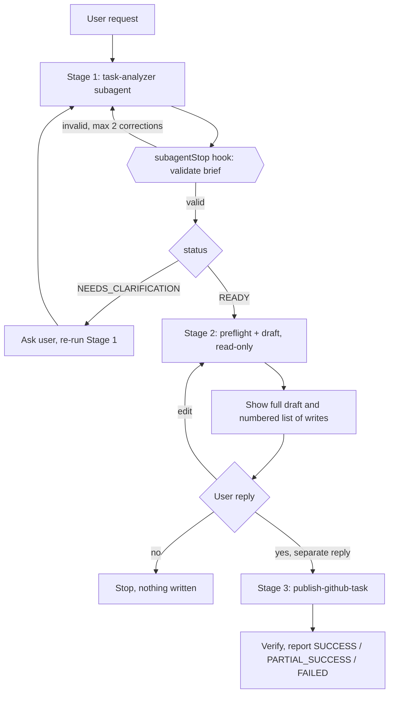

# create-github-task: how it works

Turns a plain request ("add category filters to skill search") into a GitHub issue in
`dosandk/SkillStack`, added to project board `users/dosandk/projects/10`. Nothing is written to
GitHub until the user has seen the complete draft and explicitly approved it.

This file is the overview. Details live elsewhere (see [Where things live](#where-things-live)).

## The flow



| Stage | Who | Writes to GitHub? |
| --- | --- | --- |
| 1. Analysis | `task-analyzer` subagent (read-only) | No |
| 2. Preparation | Orchestrator (`SKILL.md`): preflight checks, duplicate search, English draft from a template | No |
| Approval | The user, in a separate reply after the full draft | - |
| 3. Publication | Same agent follows `publish-github-task`: create label (if approved), create issue, add to project, verify | Yes, only the approved actions |

## Example

1. You: "File a task: users should be able to filter skills by category."
2. The analyzer returns a brief (`READY`, type `enhancement`, title, description, acceptance
   criteria), or asks questions if scope is unclear.
3. The agent checks `gh` auth, repo and project access, existing labels and similar open issues,
   then shows one message: repo, project, title, label, body, duplicates and the list of writes.
4. You reply "ok". The agent creates the issue, adds it to project 10, verifies it and reports the
   issue URL, label, project membership and a suggested branch name
   (`feature/<number>-<slug>` from `develop`, or `hotfix/<number>-<slug>` from `main`).

"Let's try" or "test it" is **not** approval. Any edit to the draft cancels an earlier "ok".

## Safety layers

| Layer | What it does | Replaces draft approval? |
| --- | --- | --- |
| Approval gate (skill instructions) | No GitHub write before an explicit yes to the shown draft | It is the approval |
| `guard-github-commands.mjs` (`beforeShellExecution`) | Cursor asks for confirmation on any `gh` command that is not a plain read, including `gh` invoked by path or inside wrappers | No, extra prompt only |
| `validate-task-handoff.mjs` (`subagentStop`) | Checks the analyzer's `task-brief` JSON and asks it to correct (max 2 times) | No, data check only |
| Publish rules | Never delete or close issues, never auto-retry `gh issue create`, report project membership only if verified | - |

## Where things live

| What | File |
| --- | --- |
| Orchestrator (stages, approval gate) | [SKILL.md](SKILL.md) |
| Contracts, templates, error handling, hook details | [reference.md](reference.md) |
| Stage 3 publishing steps | [../publish-github-task/SKILL.md](../publish-github-task/SKILL.md) |
| Analyzer subagent | [../../agents/task-analyzer.md](../../agents/task-analyzer.md) |
| Hook registration | [../../hooks.json](../../hooks.json) |
| Hook scripts and tests | [hooks/](hooks/) |
| Labels, branch naming | [contributing.md](../../../contributing.md) ("Github issue labels") |

## Requirements

- `gh` installed and authenticated, with the `project` scope for the board
  (`gh auth refresh -s project`).
- `node` on PATH for the hooks. The guard hook is `failClosed`: without `node` every `gh` command
  is blocked. See "Hook 2" in [reference.md](reference.md).

## Tests

```bash
npm run test:hooks   # mock stdin only, never runs gh; also part of pre-push
```

The approval gate and failure handling are skill instructions, not code, so they are not covered
by tests. Review them against `SKILL.md` and `publish-github-task/SKILL.md` when changing them.

## Changing the workflow

- New issue type or label: update `contributing.md`, the `ISSUE_TYPES` list in
  `hooks/validate-task-handoff.mjs`, `task-analyzer.md` and the contract in `reference.md`.
- New allowed read-only `gh` command: extend `READ_ONLY` in `hooks/guard-github-commands.mjs`
  and add a test.
- Different repo or project: the constants appear in both `SKILL.md` files, `reference.md` and
  the hook specs.
